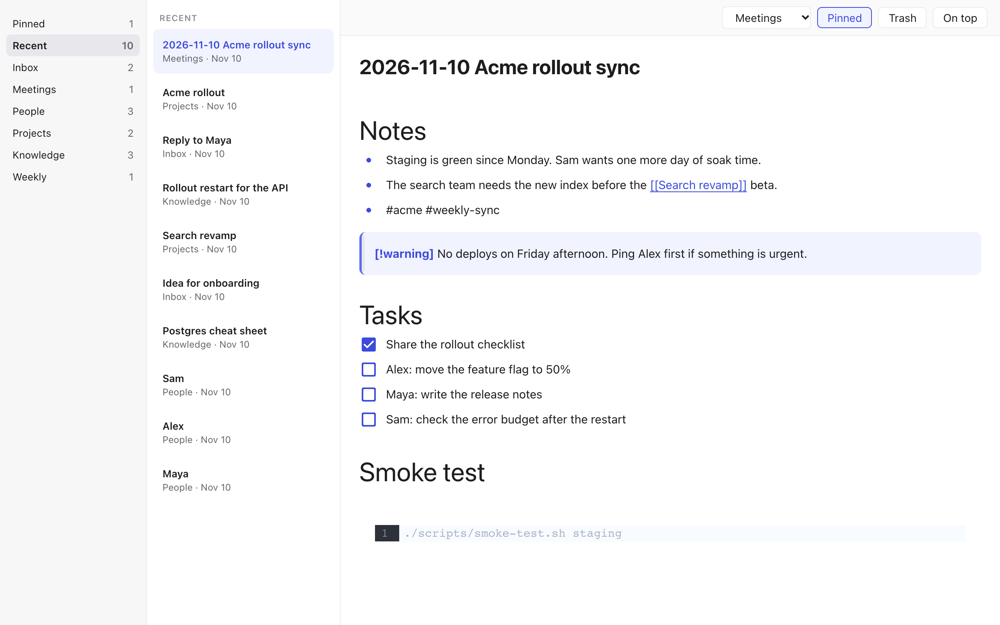
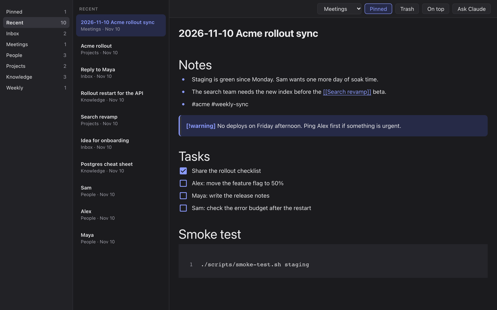
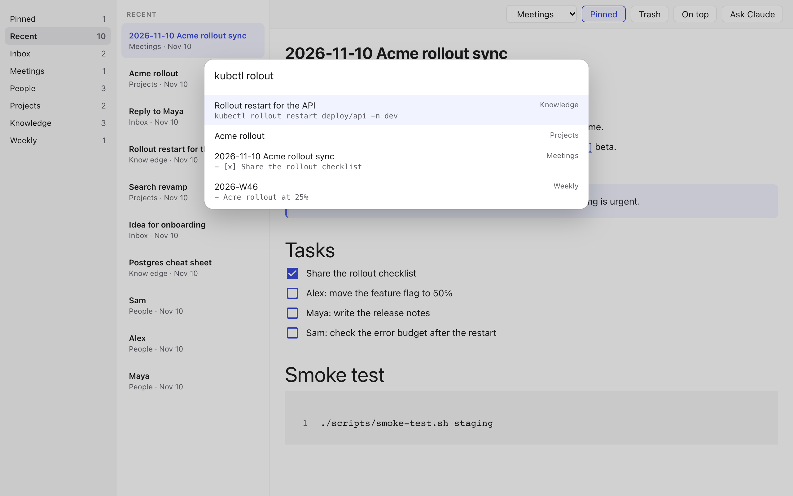
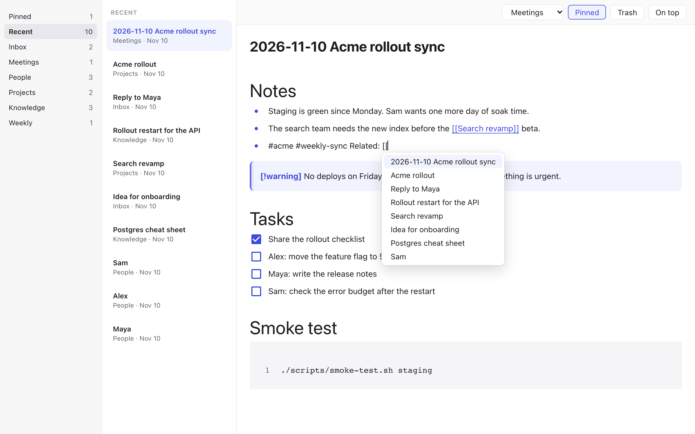
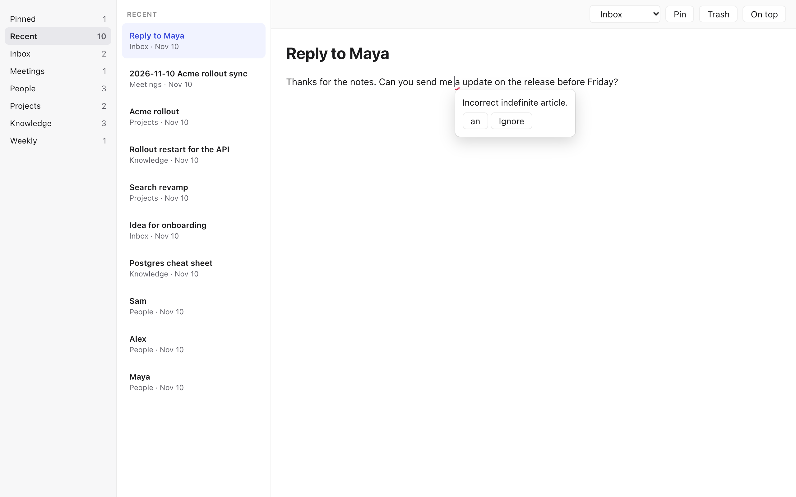
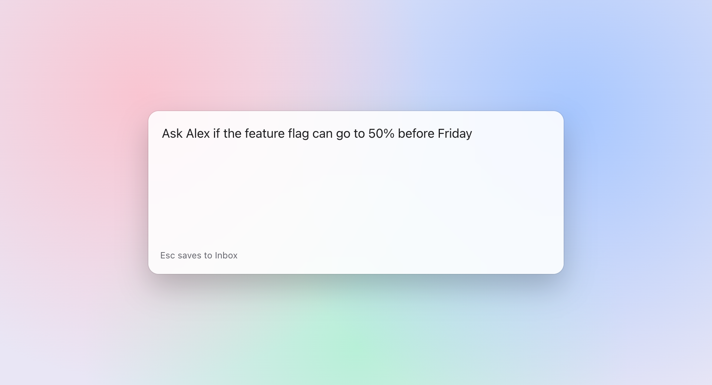
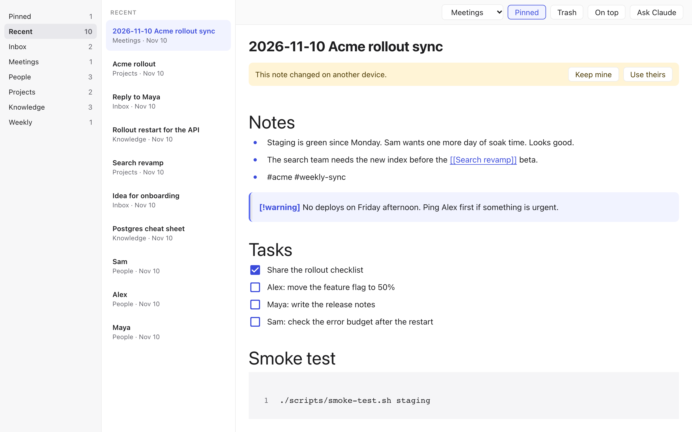
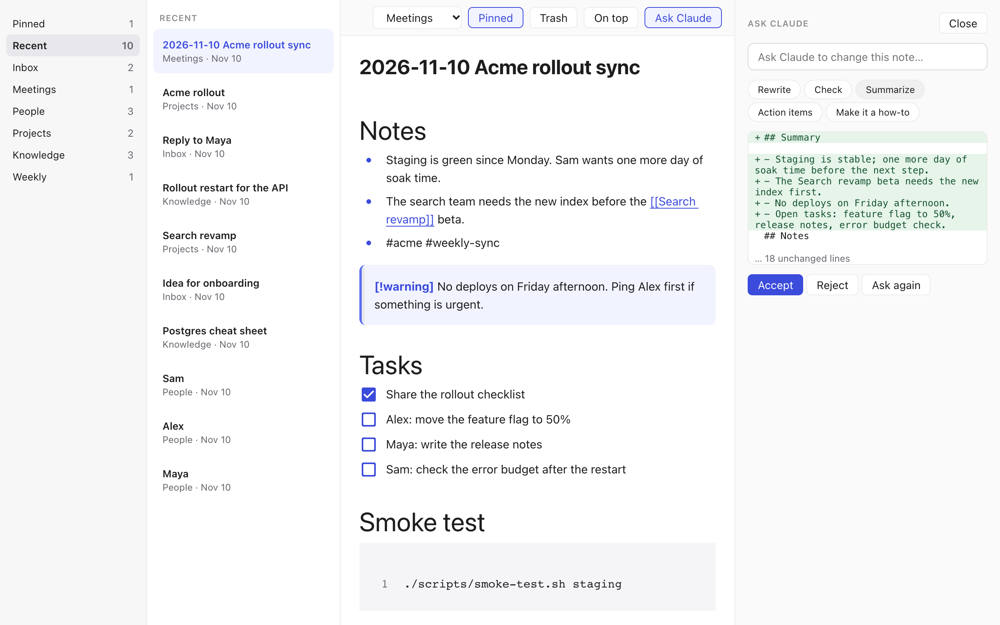
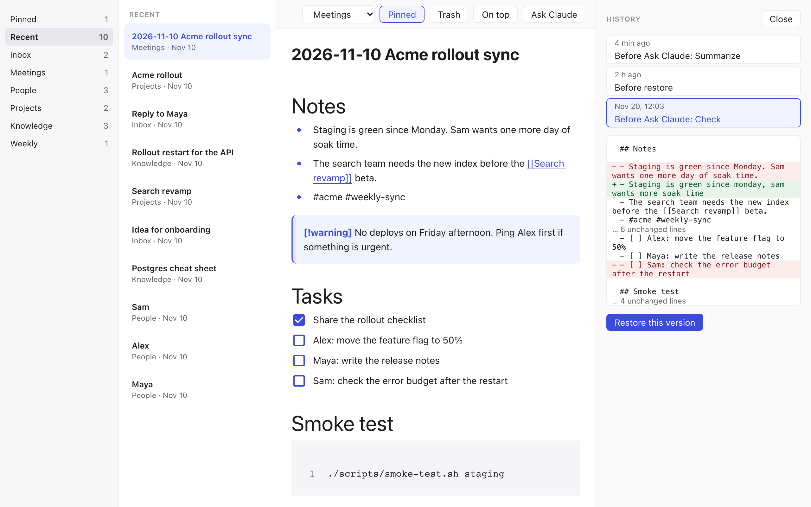

# Tack

A small macOS app for Markdown notes. Tack edits the notes of an Obsidian vault named "Tack" in iCloud, so the same notes are on the iPhone through Obsidian.

## Features


Folders on the left, notes in the middle, the editor on the right.


Tack follows the macOS dark mode.


Press `⌘K` to search all notes. Typos are fine, and you see the line that matched.


Type `[[` to link to another note.


Grammar mistakes get a wavy line. Click one to see a fix.


Press `⌥Space` in any app to write a quick note. `Esc` saves it to the Inbox.


If a note changed on another device while you typed, you choose which version to keep.


Press `⌘J` to ask Claude to change the note. You see every change first, then Accept or Reject.


Press `⌘⇧H` to see older versions of the note and restore one.

Screenshots are generated with `pnpm screenshots`.

## Claude

Ask Claude needs [Claude Code](https://claude.com/claude-code) installed and logged in. Nothing is sent until you press a button. Claude runs in safe mode and only returns text; Tack shows the change and you decide.

Tack finds `claude` through your login shell. If Claude Code is installed through nvm, or `claude` is only on your `PATH` in `.zshrc`, Tack may not find it. Set the full path in `settings.json`:

```json
{ "claude_path": "/Users/you/.nvm/versions/node/v22.0.0/bin/claude" }
```

`settings.json` is at `~/Library/Application Support/dev.ahmed.tack/settings.json`.

## Development

```sh
pnpm install
pnpm tauri dev
```

Tests: `pnpm test` and `cargo test --manifest-path src-tauri/Cargo.toml`.

## One-time setup: signing certificate

A stable certificate keeps the macOS microphone and hotkey permissions after every rebuild. Create it once:

```sh
scripts/create-signing-cert.sh
```

The script creates a self-signed code-signing certificate named `Tack Local Signing` in your login keychain. macOS asks for your login password one time to trust it for code signing.

Check that it exists:

```sh
security find-identity -p codesigning | grep "Tack Local Signing"
```

## Install

```sh
scripts/install.sh
```

The script builds a signed app, quits a running Tack, copies it to `/Applications/Tack.app` and opens it. It stops early with a message if the certificate is missing.

## First run

1. Open Tack. It asks for the vault folder.
2. Pick the iCloud folder `Tack` (the default is `~/Library/Mobile Documents/iCloud~md~obsidian/Documents/Tack/`).
3. Tack creates the missing folders and `CLAUDE.md`. Then press `⌥Space` to capture a note.
